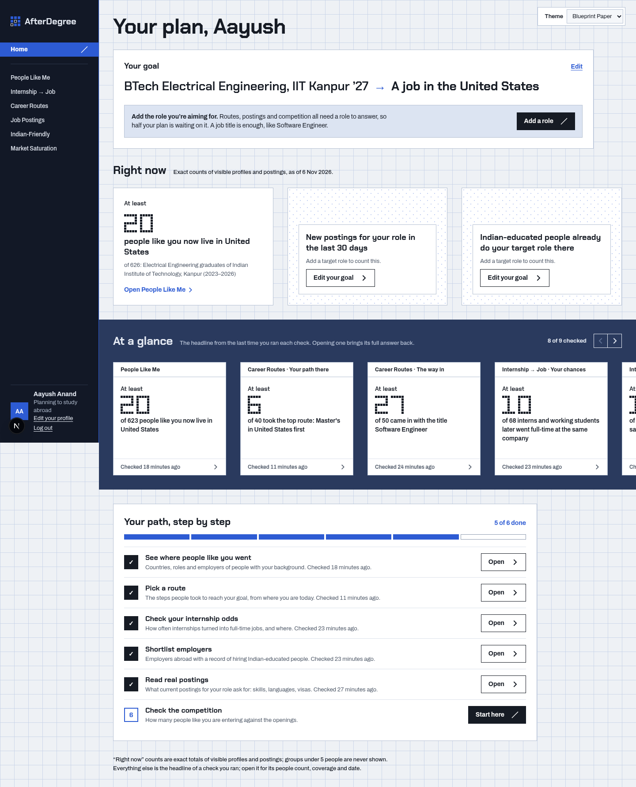
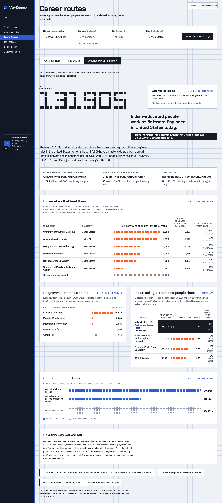
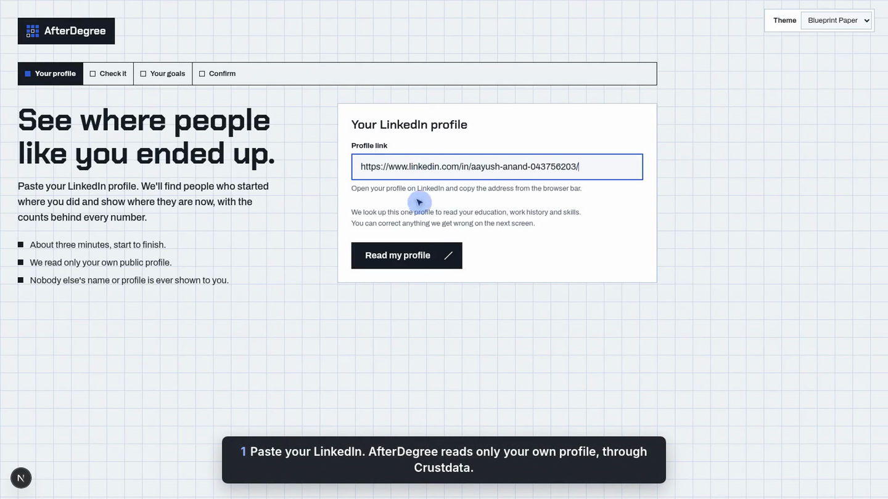
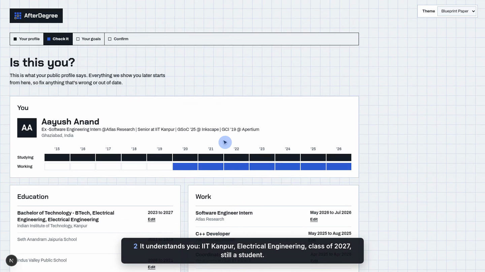
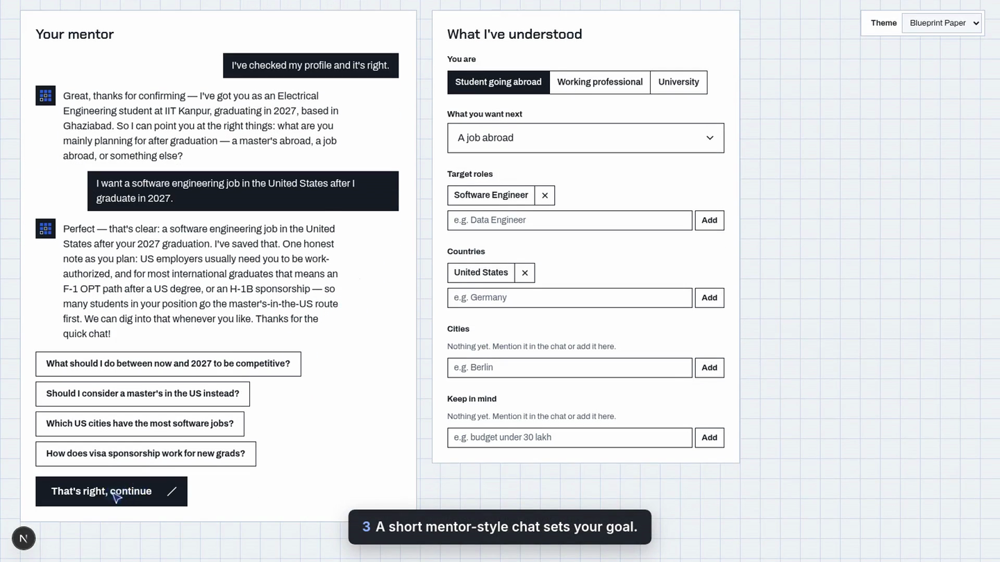
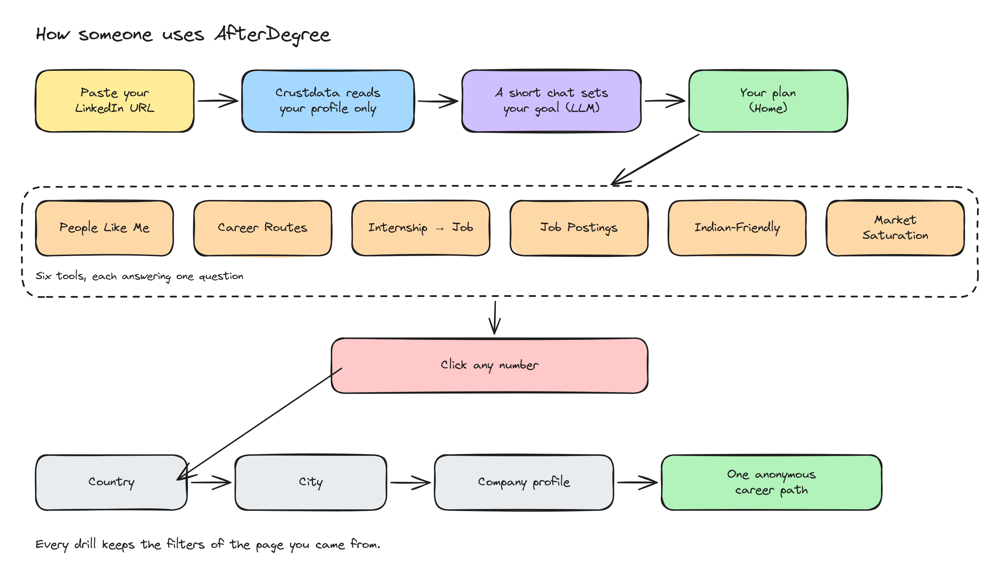
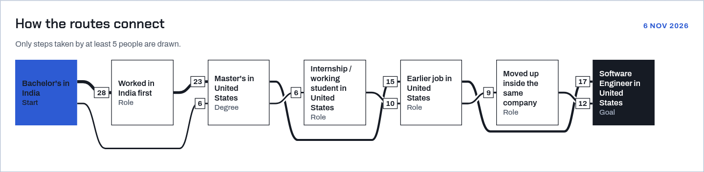
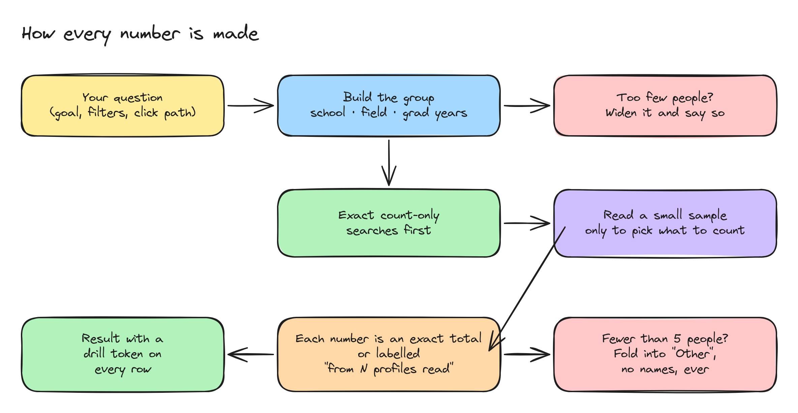
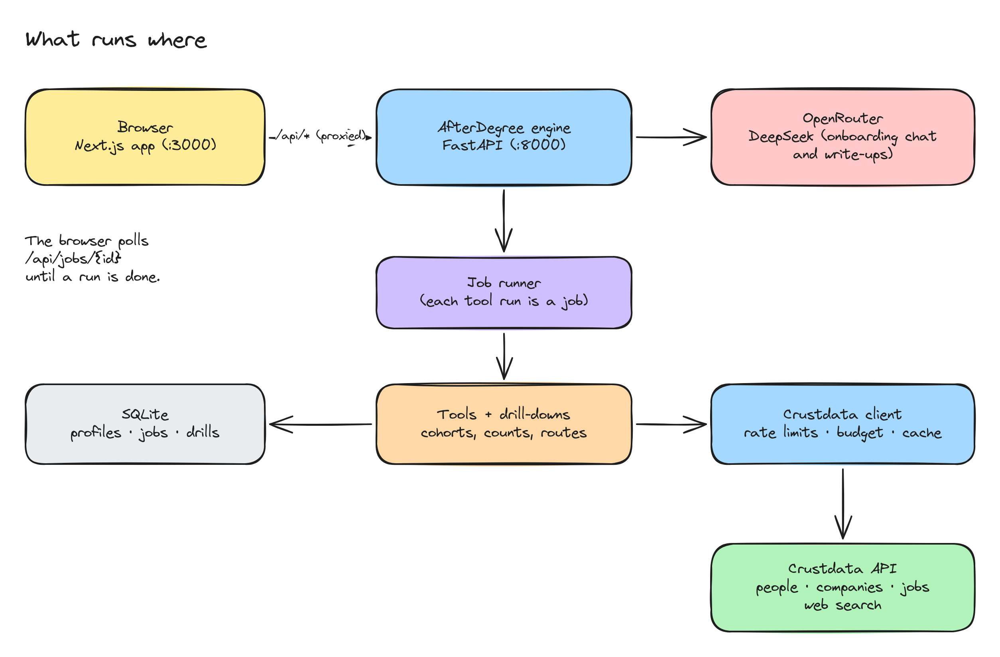

# AfterDegree

**See where people like you actually ended up, before you bet two years and ₹40 lakh on a guess.**

Every year lakhs of Indian students pick a master's abroad, a country and a first job from a
mix of agent brochures, a cousin's advice and a few LinkedIn stalking sessions. The real
answer to "what happened to people like me?" already exists. It's spread across millions
of public career histories, and nobody has put it in one place.

AfterDegree does. Paste your LinkedIn URL and it finds the people who started where you
are: same college, same branch, similar graduation year. Then it shows where they went.
Which countries, which roles, which employers, which universities and programmes got them
there, and how often internships turned into real jobs. Every number can be clicked, all
the way down to one anonymous person's career path.

Built for **ContextCon**, the Crustdata hackathon, on top of the Crustdata people,
company and job APIs.

**▶ [Watch the 2-minute demo](docs/AfterDegree-demo.mp4)**: onboarding with a real LinkedIn profile,
every tool, drill-downs to company profiles and anonymous career paths, and the university lens.



---

## What you can do with it

| Page | The question it answers |
|---|---|
| **Your plan** (Home) | Where am I, where do I want to go, and what should I check next? |
| **People Like Me** | Where did graduates with my background end up: countries, cities, roles, employers, further degrees? |
| **Career Routes** | How do I get from here to my goal? Three views of one question:<br>• **Your path there**: step-by-step routes people took, ranked by how well they fit you<br>• **The way in**: which employers, titles and schools people came from<br>• **Colleges & programmes**: which universities and master's programmes lead to the goal, their success rates, and how your own college compares |
| **Internship → Job** | How often did internships turn into full-time jobs for people like me, and which companies actually convert interns? |
| **Job Postings** | What are employers asking for right now: skills, languages, visa notes? |
| **Indian-Friendly** | Which employers abroad really hire Indian-educated people, and do they sponsor visas? |
| **Market Saturation** | How crowded is this role in this city, compared with others? |

**Universities get the same tools through an institution lens.** A placement office can see
where its graduates went, programme by programme, and which programmes lead to which jobs.



---

## Onboarding: about three minutes, start to finish

There's no form to fill in. You paste one link and have a short conversation.

**1. Paste your LinkedIn.** That's the only thing we ask for. AfterDegree uses Crustdata to read
*your* public profile, and only yours, for your education, work history and skills.



**2. Check it's you.** You see what we understood: your college, degree and graduation year,
your work and internships on a timeline, and your skills. Anything wrong or out of date can be
fixed right there. We also work out what stage you're at. An IIT Kanpur EE student graduating
in 2027 is treated as a current student, so clubs and college gigs don't count as "years of
experience".



**3. A short chat about where you're headed.** A mentor-style assistant (DeepSeek via
OpenRouter) asks what you want next: a master's abroad, a job abroad, a switch, or growing
where you are. Then it asks which countries and roles, and anything to keep in mind, like visa
sponsorship, budget or languages. You can type in your own words or tap a suggested reply.
Everything it picks up appears live on the right under *What I've understood*, where you can
edit it directly.



**4. Confirm.** One screen sums up who you are and what you're aiming for. Press
*Show me people like me* and you land on **Your plan**.

Universities go through the same steps. Pick *University* in the chat, name your institution and
the programmes you care about, and every tool switches to "your graduates".

You can come back any time through **Edit your profile** in the sidebar to change your goals,
or **Log out** to start over.

---

## How someone uses it



1. **Paste your LinkedIn URL.** Crustdata is used to read *your* profile and nothing else at this
   step. We pull out your college, branch, graduation year and work history. Current students
   are recognised as students, not as people with years of experience.
2. **A short chat sets your goal.** A warm, mentor-style conversation powered by DeepSeek
   through OpenRouter. Masters or a job? Which countries? Which roles? Any visa constraints?
3. **Your plan.** Home shows your goal in one line, a few fresh counts, the headline from every
   check you've run, and a step-by-step path.
4. **Open any tool, click any number.** Every count drills deeper:
   country → city → company → one anonymous career path. A drill always keeps the filters of
   the page you came from, so clicking *Germany* on a filtered page shows only the filtered
   people in Germany.

In Career Routes you can click a route, a step or even a single line in the route graph. You
get exactly the people who took that path, step for step, not a loose "has all these steps"
search.



---

## How every number is made

This is the part we care about most. A tool that tells students where to spend their savings
has to be honest about its numbers.



- **Exact counts first.** Every headline is a count-only search over every matching public profile,
  not an extrapolation.
- **Samples are only used to decide *what* to count.** We read a few dozen profiles to find
  which universities or employers come up, then count each one exactly. When a figure really
  does come from the profiles read (a typical route, say), it says so: "from 40 profiles read".
- **Small groups are never shown as people.** Fewer than 5 → folded into "Other". Drill-downs
  show anonymous paths only, with no names, photos, profile links or exact dates. Person-level
  data is cached for at most 7 days.
- **Thin data is said out loud.** If a group is too small we widen it (exact college → similar
  colleges → same field) and tell you we did.

---

## What runs where



- **`web/`**: Next.js (App Router) + TypeScript. Desktop-first, three themes
  (Blueprint Paper, Night Ink, Signal Orange). In live mode it proxies `/api/*` to the engine.
- **`engine/`**: Python 3.12 + FastAPI, managed with `uv`. Every tool run is a job; the browser
  polls `/api/jobs/{id}`. The Crustdata client handles per-endpoint rate limits, a per-run credit
  budget, retries and a disk cache. SQLite keeps profiles, jobs and drill results.
- **Crustdata**: person search and enrich, company identify, search and enrich, job search,
  web search.
- **OpenRouter** (`deepseek/deepseek-v4.1-flash-1017`): the onboarding chat and short write-ups.

The full API contract (tools, sections, drill tokens, people endpoints) lives in
[`docs/CONTRACT.md`](docs/CONTRACT.md).

---

## Run it locally

You'll need Python 3.12 with [uv](https://docs.astral.sh/uv/), Node 20+, and API keys for
Crustdata and OpenRouter.

```bash
git clone git@github.com:aayush01x/AfterDegree.git
cd AfterDegree

# 1. keys (never commit this file)
cat > .env <<'EOF'
CRUSTDATA_API_KEY=your-crustdata-key
OPENROUTER_API_KEY=your-openrouter-key
EOF

# 2. engine
cd engine
uv sync
uv run uvicorn afterdegree.api:app --port 8000

# 3. web (in a second terminal)
cd web
npm install
NEXT_PUBLIC_API_MODE=live ENGINE_URL=http://localhost:8000 npm run dev
```

Open http://localhost:3000 and paste a LinkedIn URL.

**No keys? Try example mode.** Run the web app alone with `npm run dev`. It serves built-in
example data in the browser, so you can click through every screen without an engine.

### Useful settings (`.env`)

| Variable | What it does |
|---|---|
| `AFTERDEGREE_MOCK=1` | Engine answers from fixtures instead of live Crustdata |
| `AFTERDEGREE_MAX_CREDITS` | Credit budget per tool run |
| `AFTERDEGREE_DRILL_MAX_CREDITS` | Credit budget per drill-down |
| `AFTERDEGREE_CACHE_TTL_DAYS` | Disk cache lifetime (person data is capped at 7 days regardless) |
| `OPENROUTER_MODEL` | Swap the LLM |

### Tests

```bash
cd engine && uv run pytest -q          # engine: tools, drills, counting rules, privacy
cd web && npx tsc --noEmit -p . && npx eslint src
```

---

## Cost

A fresh run of a tool costs roughly 2–25 Crustdata credits. Re-runs are mostly free, because
samples are served from already-paid cached pages. Drill-downs cost about 11 credits for a
country, about 18 for a full company profile, and nothing for route drills, which reuse the
profiles the page already read. Tool pages never search on their own. They wait for you to
press the button, so browsing doesn't burn credits.

---

## Project layout

```
engine/afterdegree/
  api.py            FastAPI routes
  jobs.py           job runner (each tool run is a job)
  crustdata.py      client: rate limits, budget, cache, credit log
  profile.py        LinkedIn profile → your background (field, grad year, student or not)
  cohort.py         "people like you", with labelled widening
  tools/            one module per tool (people_like_me, reverse_gps, college_paths, …)
  drill.py          every click: exact slices, company profiles, anonymous paths
  home.py           "Your plan" runs + snapshot
web/src/
  app/              routes (home, tools, explore, people, onboarding)
  features/         one folder per tool view
  components/       shell, data viz, drill-down pages, theme switcher
docs/
  CONTRACT.md       API contract between web and engine
  diagrams/         Excalidraw sources (.excalidraw) and rendered PNGs
```

The diagrams are real Excalidraw files. Open any `docs/diagrams/*.excalidraw` on
[excalidraw.com](https://excalidraw.com) to edit them, or re-render all three with
`node web/scripts/render-diagrams.mjs` (needs Chrome).

---

## Data and privacy

AfterDegree only ever shows other people as **anonymous trajectories**: steps with years, never
names, photos, profile links or exact dates, and never a group smaller than five. It follows
Crustdata's data terms. Person-level data expires from the cache within 7 days. Your own
profile is only used to find people like you.

---

Built during ContextCon.
